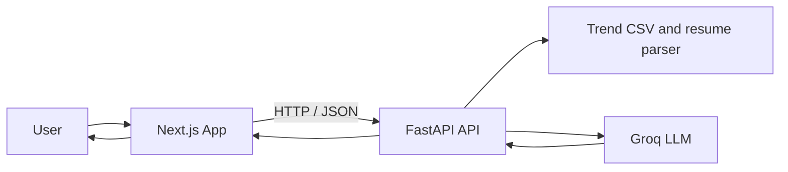

# Un-HiReD — Future-Ready Workforce Co-Pilot

## Team Information

| Field | Details |
|---|---|
| Team name | [Team Name] |
| Institution | [Institution] |
| Country | Malaysia |
| Track | AI, skills, and future-ready work |

## Links

| Resource | Link |
|---|---|
| Source code | [Add repository URL] |
| Live demo | [Add deployed application URL] |
| Demo video | [Add video URL] |
| Preliminary proposal | `submission/SDC2026_TeamName_Preliminary.pdf` |
| Technical declaration | `submission/SDC2026_TeamName_TechDeclaration.pdf` |
| Replit proof of use | `submission/SDC2026_TeamName_Replit_POU.pdf` |

## Overview

### Problem

People changing careers or entering the workforce can struggle to understand which roles fit their current skills, what they need to learn, and how job-market changes may affect their plans.

### Solution

Un-HiReD is a career co-pilot that compares a person's profile with job-market signals, ranks future roles with explainable match scores, and suggests practical next steps.

### Key Features

- Resume upload and skills profile intake.
- Ranked future roles with match scores, skills gaps, and demand signals.
- Job-description matching and resume improvement suggestions.
- Ordered learning pathway with estimated study times and learning links.
- Career impact mapping to UN Sustainable Development Goals.
- Clearly labeled future scenarios to help users consider uncertainty.
- English, Bahasa Malaysia, and Chinese interface options.

### Tech Stack

- Frontend: Next.js, React, TypeScript, Tailwind CSS.
- Backend: Python, FastAPI, Pandas.
- AI: Groq API using the OpenAI-compatible Python SDK.
- Data: CSV trend dataset with source metadata.

## Project Structure

```text
.
├── docs/                       # Project documentation
├── frontend/                   # Next.js application
├── src/                        # FastAPI application and backend data
│   ├── data/job_trends.csv
│   ├── main.py
│   ├── resume_parser.py
│   ├── trend_analyzer.py
│   └── start_backend.ps1
├── submission/                 # Hackathon submission documents
├── tests/                      # Test support and test files
├── .env.example                # Required environment variable names
├── requirements.txt            # Python dependencies
└── README.md
```

## Architecture



The user provides a resume or profile and a career goal. The frontend sends the information to the FastAPI service. The API combines verified profile details with trend data and, when configured, requests structured recommendations from the LLM. The API returns results for the dashboard.

## How to Run

### Local VS Code setup

1. Open the repository root in VS Code.
2. If `src/.env` does not already exist, copy `.env.example` to `src/.env`. Add your own `GROQ_API_KEY` there and keep it private. Do not replace an existing local `src/.env`.
3. In a PowerShell terminal at the repository root, create and activate the Python environment:

   ```powershell
   py -3.13 -m venv .venv
   .\.venv\Scripts\Activate.ps1
   python -m pip install -r requirements.txt
   ```

4. Start FastAPI from the repository root:

   ```powershell
   .\src\start_backend.ps1
   ```

   The API is available at `http://127.0.0.1:8000`; interactive API documentation is at `http://127.0.0.1:8000/docs`.

5. Open a second terminal and start the frontend:

   ```powershell
   cd frontend
   npm install
   npm run dev
   ```

6. Visit `http://localhost:3000`.

## Challenges & Learnings

- Keeping resume extraction grounded in text actually present in the document.
- Handling unreliable model responses with structured JSON, clear errors, and a local fallback for role recommendations.
- Connecting market signals, skill gaps, and learning steps while keeping each recommendation explainable.
- Making the experience usable across languages, themes, and screen sizes.

## Future Improvements

- Connect the trend layer to a regularly refreshed, clearly documented data source.
- Validate recommendations with career advisers and Malaysian employers.
- Add more localized learning resources and HRD Corp-claimable programme information.
- Expand accessibility checks, evaluation, and automated test coverage.
- Support user accounts and secure cloud storage for profiles and resumes.

## Team

| Name | Role | Contribution |
|---|---|---|
| [Member name] | [Role] | [Contribution] |
| [Member name] | [Role] | [Contribution] |
| [Member name] | [Role] | [Contribution] |

## Submission Checklist

- [ ] Complete team details and replace all placeholders.
- [ ] Add the source repository, live demo, and demo video links.
- [ ] Add the required preliminary proposal PDF.
- [ ] Add the technical declaration PDF.
- [ ] Add the Replit proof-of-use PDF.
- [ ] Confirm the application starts using the local setup instructions.
- [ ] Check that no API keys or private environment files are included in the submission.

